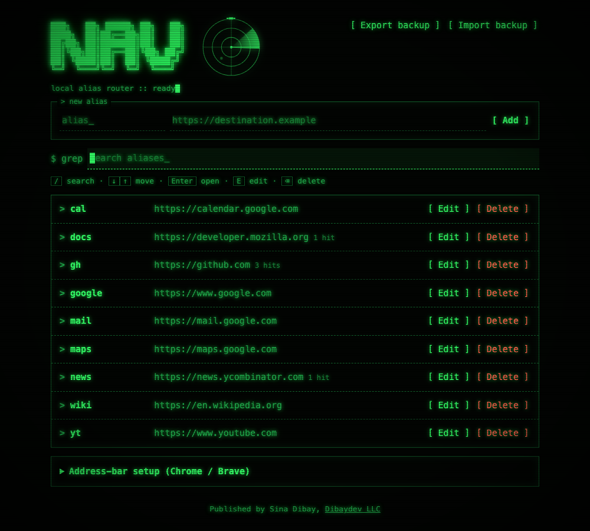

# Naav (ناو)



A tiny, local, personal URL alias router for macOS (Chrome & Brave).
Type `nav gh` in the address bar → land on GitHub. Manage everything in a built-in UI — no config files.

- Single static Go binary (`naavd`), assets embedded, works fully offline
- Binds to `127.0.0.1` only (default port 4747, reachable as `naav.localhost`); no telemetry, no auth, no external calls
- Aliases live in memory; persisted as one zlib-compressed binary file `~/.naav/aliases.bin` (atomic writes)

## Install

### Homebrew (recommended)

Naav is available on Homebrew through its own tap:

```sh
brew tap Dbaydev-LLC/naav
brew trust Dbaydev-LLC/naav     # newer Homebrew asks you to approve third-party taps
brew install naav
brew services start naav        # runs at login, restarts if it stops
```

Then open <http://naav.localhost:4747/>. Update later with `brew update && brew upgrade naav`.
Uninstall with `brew services stop naav && brew uninstall naav` (your aliases in `~/.naav` are kept).

> On an older Homebrew without `brew trust`, just skip that line.

### From source (no Homebrew)

Needs [Go](https://go.dev/dl/) 1.24+. Builds the binary and installs it as a login service:
```sh
git clone https://github.com/Dbaydev-LLC/naav.git && cd naav
make build && ./naavd install      # start at login, auto-restart; ./naavd uninstall removes it
```
Run it in the foreground instead with `./naavd`.

Options: `--port 4747` (or `NAAV_PORT`), `NAAV_DIR` to change the data folder (default `~/.naav`).

## Hook up the address bar (Chrome / Brave)

Settings → Search engine → Manage search engines and site search → **Add**:

| Field | Value |
|---|---|
| Name | Naav |
| Shortcut | `nav` (or `naav`; add both if you like) |
| URL | `http://naav.localhost:4747/%s` |

Opening `http://naav.localhost:4747/%s` itself shows these instructions inside the dashboard. Then `nav gh`, `nav gh/org/repo` (path forwarding), or open <http://naav.localhost:4747/> for the dashboard.
Unknown alias → the dashboard opens with the alias pre-filled; paste a URL, press Enter, and you're redirected.

> Typing `nav`, pressing Space/Tab and then Enter with nothing after it opens the dashboard (empty `%s` → `/`).
> If you change the port, use the same port in the URL above.

## Dashboard

Search (`/` to focus, ↓/↑ to move, Enter to open, `E` edit, ⌫ delete), quick-add (`https://` is added if missing),
inline edit/delete, **Export backup** (`.naav`) and **Import backup** (merge or replace).

## Security notes

The API only answers `Host: 127.0.0.1`, `localhost` or `*.localhost`, rejects foreign `Origin`s and requires a custom header on writes,
so other websites can't add aliases or rebind DNS to your daemon. Only `http(s)` destinations are accepted.

## Development

`make test` · `make dist` (darwin arm64 + amd64 tarballs) · tag `vX.Y.Z` to trigger the release workflow.

MIT licensed. Made by [Sina Dibay](https://github.com/sinadbay) · [dbay.dev](https://dbay.dev/). Contributions welcome — open an issue or PR.
